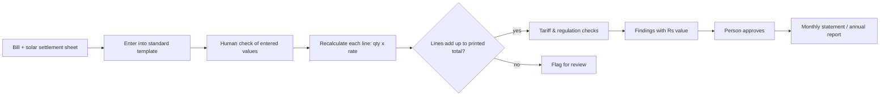

# Industrial Electricity Bill Audit & Reconciliation

**Rebuilt real high-tension (HT) electricity bills line by line, reconciled them to the printed total, and identified ~Rs 18 lakh/year in recoverable costs for one textile manufacturer.**

Industrial consumers in Gujarat with open-access solar get two documents each month: the utility bill and a solar settlement sheet. The two are hard to read together, errors go unnoticed, and exemptions or credits can lapse quietly. This project checks every line and puts a rupee value on every problem.

> The production engine and client bills are private. This repo explains the method and includes a runnable demo on **synthetic** data.

## Results on real bills (anonymised)

- Bills from 3 textile manufacturers across 3 utility divisions
- Clean bills reconciled **to the paisa** (demand, energy, duty, surcharges, solar credit)
- Bills whose own printed lines did not add up were flagged for review instead of being "fixed"

| Finding (one client) | Value per year |
|---|---|
| Electricity-duty exemption had lapsed | ~Rs 15 lakh |
| Contract demand set higher than needed | ~Rs 1.19 lakh |
| Banked solar energy lapsing against the 30% cap | ~Rs 2.11 lakh |
| **Total** | **~Rs 18 lakh** |

Other findings from real documents:
- Solar credits settle **one month in arrears**, so settlement month and bill month must be tracked separately.
- One utility settlement sheet had a **labelling error** in its own figures.
- Some bills print the same charge twice with different values; the analysis waits for a person rather than guessing.

## Method



Rules followed:
1. **Document first:** money figures come from the bill and settlement sheet, never from assumptions.
2. **Missing is not zero:** a value not on the document is shown as "not available", not Rs 0.
3. **Nothing reaches a client** until the month reconciles and a person approves the finding.

## Demo (synthetic data)

`sample_data/synthetic_bills.csv` has two invented months. Run:

```
pip install pandas matplotlib
python reconcile_demo.py
```

It recalculates each line, checks the total, and draws a "why did my bill change" waterfall. February is built with a deliberate Rs 1,000 gap so the check can be seen failing.


**Tools:** Python, pandas, SQL (SQLite), Excel, FastAPI. Production system built with AI-assisted development.
